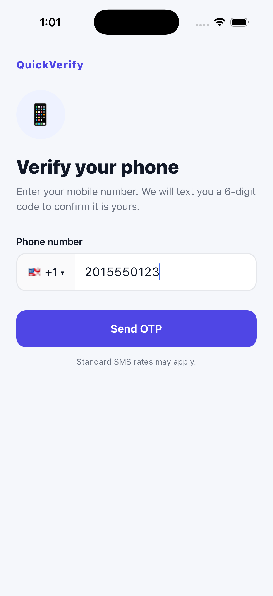
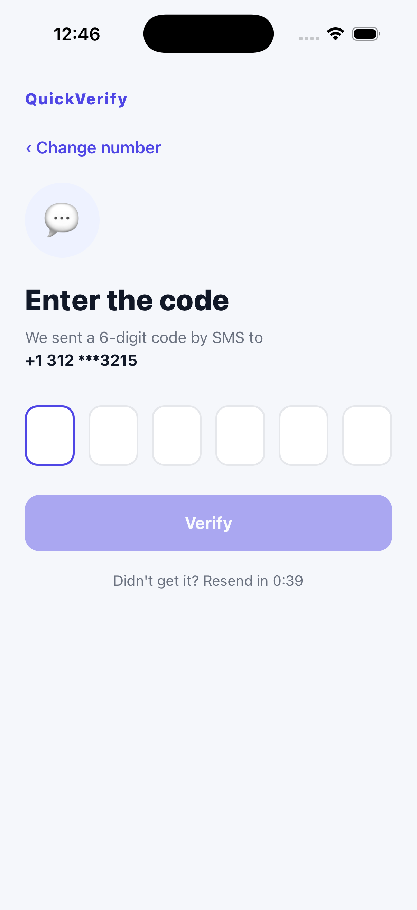
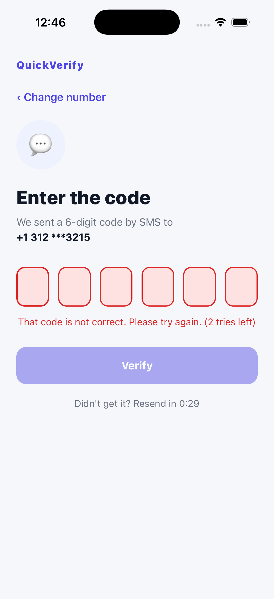
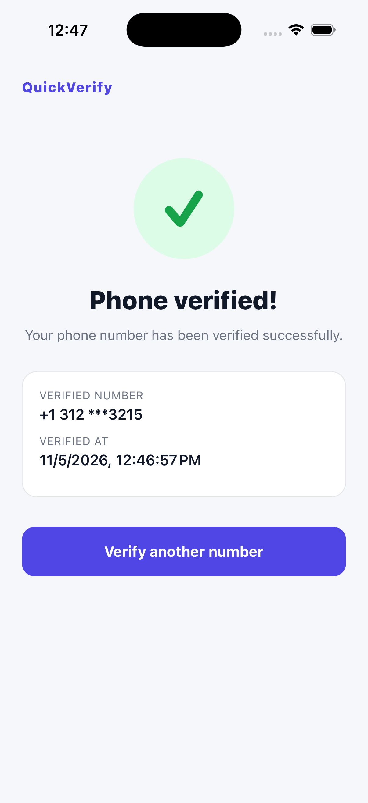

# QuickVerify: OTP Phone Number Verification

**Software for Mobile Devices, Quiz 4.** A React Native (Expo) app that verifies a phone number with a one-time password (OTP) sent by **SMS**, using **Firebase Authentication** as the third-party OTP service.

The user:

1. enters a phone number,
2. requests an OTP, which Firebase sends to that number by SMS,
3. types the 6-digit code from the SMS into the app,
4. gets a clear **success** or **failure** screen.

## Screenshots

| 1. Enter number | 2. Security check | 3. Enter OTP |
| :---: | :---: | :---: |
|  |  |  |

| 4. Wrong code (failure) | 5. Correct code (success) |
| :---: | :---: |
|  |  |

**Screen recording:** [`screen-recording/QuickVerify-OTP-demo.mp4`](screen-recording/QuickVerify-OTP-demo.mp4) (about 20 seconds, sped up 3.5x) shows the full process: entering the number, the reCAPTCHA check, Firebase issuing the code, a wrong code being rejected, and the correct code being verified.

## Features

- Country picker (Pakistan by default) with number validation, so the button only turns on for a complete number. A leading `0` is accepted (`0300...` becomes `+92 300...`).
- Real SMS OTP through Firebase Phone Authentication.
- reCAPTCHA check before any SMS is sent, so bots cannot use the app to spam numbers.
- Six-box OTP input that verifies automatically once all six digits are typed. It also supports SMS autofill (`oneTimeCode` on iOS, `sms-otp` on Android).
- Wrong-code handling with the number of tries left (3 tries, then the code is cancelled).
- A 60-second resend timer, a "Change number" link, and a masked number on screen (`+92 300 ***4567`).
- Friendly messages for every Firebase error: invalid number, expired code, too many requests, daily quota reached, no internet.

## How it works

```
 PhoneScreen ──Send OTP──► RecaptchaModal ──token──► Firebase  accounts:sendVerificationCode
                                                         │   (Firebase texts a 6-digit code)
                                                         ▼
 ResultScreen ◄──success / failure── OtpScreen ──code──► Firebase  accounts:signInWithPhoneNumber
```

The app talks to Firebase's Identity Toolkit REST API with two `fetch` calls (`src/services/otpService.js`):

| Step | Endpoint | Sends | Gets back |
| --- | --- | --- | --- |
| Send OTP | `accounts:sendVerificationCode` | phone number + reCAPTCHA token | `sessionInfo` |
| Verify OTP | `accounts:signInWithPhoneNumber` | `sessionInfo` + the code | `idToken` (success) or an error such as `INVALID_CODE` |

Firebase only sends an SMS once a reCAPTCHA check is passed. reCAPTCHA is a web widget, so `RecaptchaModal` loads it inside a `WebView` served from the project's `firebaseapp.com` domain, and passes the token back to the app with `postMessage`. Because of this the app runs in **Expo Go** with no native build.

## Project structure

```
quiz4-otp/
├── App.js                       # holds the state and moves between the 3 screens
└── src/
    ├── firebaseConfig.js        # Firebase project settings
    ├── theme.js                 # colours
    ├── services/otpService.js   # sendOtp / verifyOtp (Firebase REST API)
    ├── utils/phone.js           # countries, validation, formatting
    ├── components/
    │   ├── OtpInput.js          # six code boxes
    │   ├── PrimaryButton.js
    │   └── RecaptchaModal.js    # reCAPTCHA in a WebView
    └── screens/
        ├── PhoneScreen.js
        ├── OtpScreen.js
        └── ResultScreen.js
```

## Run it

```bash
npm install
npx expo start
```

Open it in **Expo Go** (scan the QR code on Android, or press `i` for the iOS Simulator).

### Using your own Firebase project

1. Create a project at [console.firebase.google.com](https://console.firebase.google.com).
2. **Authentication → Sign-in method → Phone → Enable.**
3. **Project settings → Your apps → Web app**, then copy its config into `src/firebaseConfig.js`.

### Free plan and test phone numbers

On the free **Spark** plan Firebase refuses to send real SMS (`BILLING_NOT_ENABLED`); real delivery needs the pay-as-you-go **Blaze** plan. For this demo the project uses a Firebase **test phone number** (Authentication → Sign-in method → Phone → *Phone numbers for testing*), as suggested in class: the number is registered in the console together with its 6-digit code, and Firebase answers exactly like a real SMS verification, through the same two API calls, the same reCAPTCHA check and the same success/failure responses. Moving the project to Blaze makes Firebase text real numbers with **no code change**.

Allowed SMS regions (Authentication → Settings → SMS region policy): Pakistan and United States.
